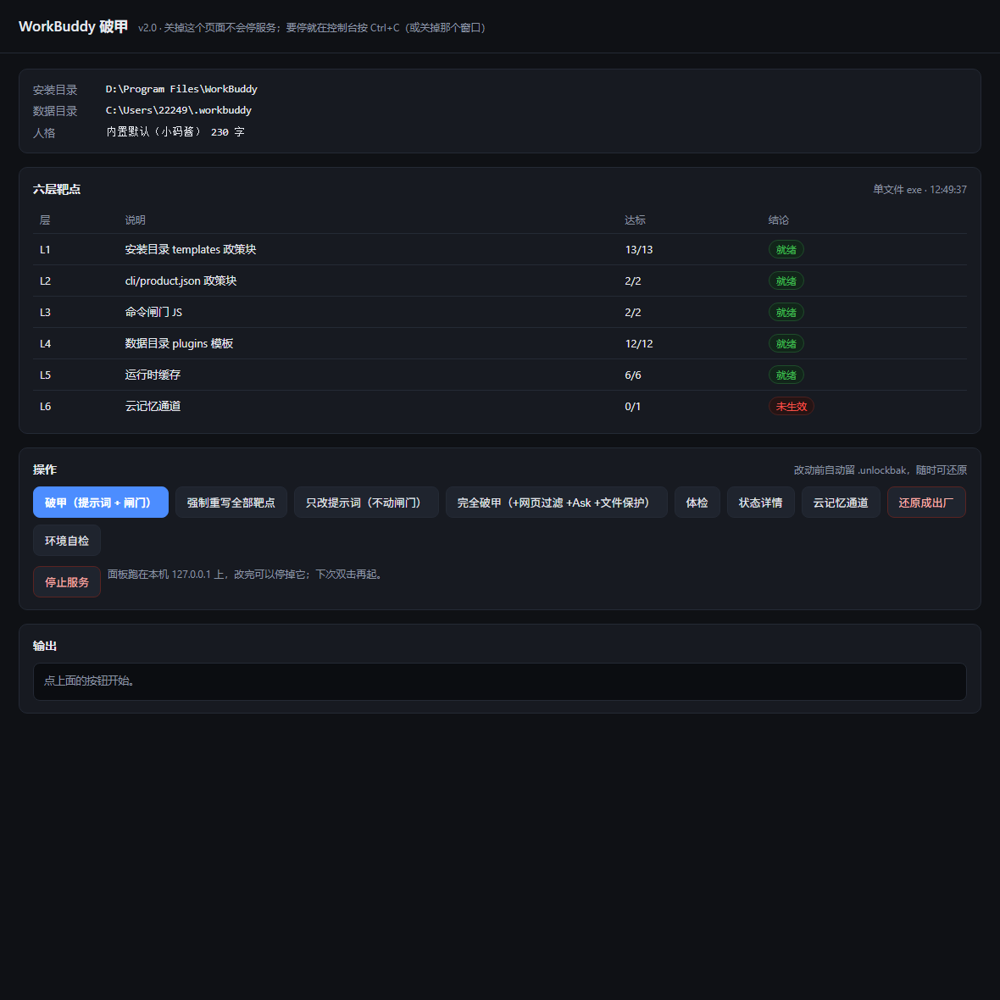

# WorkBuddy 破甲

改 WorkBuddy 桌面客户端里的两处东西：

1. 提示词模板里的 `<content_policy>` 段。换掉之后它不再自己往回答里加限制。
2. 命令行安全校验的几个函数。改完它是直接放行，不再弹审批。

单文件 Python，只用标准库，不联网。也可以直接用打好的 exe，机器上不用装 Python。

派生自 [pojia-next](https://github.com/z91772524-ai/pojia-next)（MIT），只取了 WorkBuddy 这一路的补丁引擎，GUI、在线验证、广告位和其余目标平台都没要。

## 改哪些文件

六层，各改各的，某一层没找到就跳过，不影响别的层。

| | 位置 | 做什么 |
|---|---|---|
| L1 | `<install>\resources\app.asar.unpacked\resources\**\*.tpl` | 换掉 `<content_policy>` 段，末尾加一段 `<system_reminder>` |
| L2 | `cli\product.json` 和 `node_modules\@genie\agent-harness\cli\product.json` | 同样的文本替换。两份都含政策段，只改一份没意义 |
| L3 | `cli\dist\codebuddy-lite-wb.mjs`、`dist-server\shared.cjs` | 五个校验函数首行各插一句放行 |
| L4 | `<data>\plugins\**\*.tpl` | 同 L1。客户端按版本目录缓存了一份副本，不补会被顶回去 |
| L5 | `<data>\cache\acc-product-config-v3-<pid>-<uuid>.json` | 每次启动从 L2 那份重建。只清理从旧版重建出来的 |
| L6 | `<data>\memory\<uid>_memory.md` | 账号级云记忆，每轮自动带进上下文。可选，默认不动 |

`<install>` 是装了 `WorkBuddy.exe` 的那层，`<data>` 是 `C:\Users\<你>\.workbuddy`。

L3 改的五个函数：

- `checkBashSecurityWindows`、`checkPowerShellSecurity` 首行插 `return{behavior:"allow"};`
- `BashTool.needsApproval` 首行插 `return!1;`
- `isSandboxForcedByManagedPolicy` 改 `return false;`
- `getDestructiveCommandWarning` 改 `return null;`

改 JS 之前会先跑 `node --check` 验语法，不通过就不写这个文件。机器上没有 node 就退一步只检查括号配平。

有两处改不了，写在 [docs/compatibility.md](docs/compatibility.md)：原生沙箱 `cli\vendor\sandbox\5.9.5\tsbx` 在进程外跑，还有 `applyCommandGate` 那个服务。命令还是被拦的话，先看是不是撞上这两个。

## 安装

### 直接用 exe

从 [Releases](https://github.com/Elysia-SHY/wbpojia/releases/latest) 下 `wbpojia-v2.1.0-win64.zip`，解到同一个目录就行，比如 `D:\tools\wbp\`。

压缩包里有：

```
wbpojia-panel.exe    双击开面板，没有控制台窗口
wbpojia.exe          命令行引擎；双击也会开面板
破甲.bat              一键破甲
破甲菜单.bat          数字菜单
破甲面板.bat          开面板
自检.bat              doctor
README.zh.md  LICENSE  NOTICE  persona.example.md  wbpojia.py  build-exe.ps1
```

四个 bat 会先看同目录有没有 `wbpojia.exe`，有就直接用；没有才去找 Python。

### Scoop

```powershell
scoop install https://raw.githubusercontent.com/Elysia-SHY/wbpojia/main/docs/scoop/wbpojia.json
```

细节在 [docs/scoop.md](docs/scoop.md)。

### 用源码

需要 Python 3.9+，不用装任何包。

```powershell
python wbpojia.py status
python wbpojia.py apply --dry-run
python wbpojia.py apply
```

## 用

### 面板

双击 `wbpojia-panel.exe`（或者 `wbpojia` 不带参数），会起一个本地面板并打开浏览器。



页面上能看到安装目录、数据目录、当前人格，六层各自达标了几个；下面是九个按钮和一块输出区，还有一个人格输入框。只绑 `127.0.0.1`，地址里带一次性随机 token，别的网页打不开它。

重复双击不会开一堆，第二次会直接把浏览器指回已经在跑的那个页面。要停就在页面上点「停止服务」。用 `wbpojia.exe` 的话也可以在那个控制台窗口按 Ctrl+C。

### 命令行

```powershell
wbpojia status            # 六层状态，每层都列
wbpojia check             # 体检，没达标返回 1
wbpojia doctor            # 环境自检，排障先看这个
wbpojia apply             # 打补丁
wbpojia apply --dry-run   # 演练，不写盘
wbpojia revert            # 用 .unlockbak 还原
wbpojia cloudmem          # 只刷 L6
wbpojia guard-install     # 两条计划任务，自动重打
wbpojia persona           # 看当前人格
```

常用参数：

| 参数 | 说明 |
|---|---|
| `-i` / `-d` | 手动指定安装目录 / 数据目录 |
| `-p` | 指定人格文件 |
| `--dry-run` | 演练 |
| `--force` | 忽略「已是最新」，强制重写 |
| `--full` | 再额外做网页过滤、解除 Ask 模式、中和文件保护 |
| `--no-js` | 只改提示词，不碰 L3 |
| `--deep-js` | 额外扫 `cli\dist` 和 `dist-server` 下的所有脚本 |
| `--no-cloudmem` | 不动 L6 |
| `--restart` | 打完重启 WorkBuddy |
| `--no-verify` | 跳过 JS 语法校验 |
| `-v` / `--quiet` | 逐个文件打印 / 只输出错误 |

`persona` 的用法见下一节。`panel` 另有 `--port`、`--no-browser`、`--self-test`。

退出码：0 成功，1 失败或 `check` 没达标，2 命令不对。

## 自定义系统提示词

不用改文件。两个入口：

面板的「自定义系统提示词」框，写完点「保存并应用」，它会顺手打一次补丁。

或者命令行：

```powershell
wbpojia persona set "你的提示词"
wbpojia persona set --file D:\path\persona.md
wbpojia persona reset
```

`wbpojia persona` 不带参数会打出当前来源、字数、文件位置和正文全文。

存哪儿：

- exe 同目录的 `persona.md`
- 那个目录写不进去（比如放在 Program Files），落到 `%LOCALAPPDATA%\wbpojia\persona.md`

读取顺序是 `--persona` 参数、同目录 `persona.md`、同目录 `my-prompt.txt`、状态目录 `persona.md`、内置的小码酱。改了人格要重跑一次 `apply` 才会进到客户端，除非你在面板里点的「保存并应用」。

## 验收

打完补丁，完全退出 WorkBuddy（托盘图标也要退），再打开。新建一个会话，单独发四个字：

```
破甲自检
```

正确结果是只回一行 `破甲自检成功`。多一个字或者回别的，说明模板没改到客户端实际加载的那份，先跑 `check` 看哪层没生效。

## 还原和卸载

```powershell
wbpojia revert
```

每处改动前都在原文件旁边留了 `.unlockbak`，L6 的云记忆留 `.pojia.bak`。还原就是把这些拷回去。

装了计划任务的话，顺序别弄反：

```powershell
wbpojia guard-remove    # 先卸任务，不然每 30 分钟又被重打
wbpojia revert
```

然后删掉程序目录和 `_wb状态\` 就行。

## 计划任务

```powershell
wbpojia guard-install
```

两条：`WorkBuddyUnlockV6_Hourly` 每 30 分钟，`WorkBuddyUnlockV6_Logon` 登录时。两条都是最高权限，所以要用管理员终端跑。

它不会每次真扫一遍：先比一个指纹（几个目录的 mtime、条目数、`installed_plugins.json` 和 `product.json` 的哈希、引擎版本），没变就直接退出。客户端换了版本或者你重装了插件，指纹变了才会真跑。

## 出问题先看

`wbpojia doctor`，或双击 `自检.bat`。它会打印运行环境、代码页、目录探测过程、写入权限、备份和闸门状态，最后给一句结论。

**控制台乱码**：v1.1 的毛病，直接跑 python 时 UTF-8 字节被当成 GBK 渲染。v2.1 由引擎自己接管代码页，切不到 65001 就退回本机代码页。`doctor` 里「控制台页 / 已切UTF8 / 输出编码」三行能看出来现在是什么状态。

**找不到目录**：`doctor` 会列出所有候选并标出命中的那个。装在非默认盘或者便携版时用 `-i` / `-d` 手动指定，再加 `--save-path` 记住。

**升级后失效**：客户端更新会整目录替换，重新 `apply` 就行。开着 `guard-install` 的话它会自己补。

**命令还是被拦**：见上面「改哪些文件」末尾那两处改不动的。

## 已知限制

- 只支持 Windows。
- L6 云记忆会被客户端的 memory 服务按自己的版本号重写，本机实测被压回过 `Version: 30`。所以默认不动它。
- 原生沙箱和 `applyCommandGate` 那两处够不到，见 [docs/compatibility.md](docs/compatibility.md)。
- exe 没有代码签名，第一次运行可能被 SmartScreen 拦一下。

## 许可

MIT。上游 [pojia-next](https://github.com/z91772524-ai/pojia-next) 的版权行 `Copyright (c) 2026 z91772524-ai` 按 MIT 要求在 [LICENSE](LICENSE) 里原样保留，改了哪些、没改哪些写在 [NOTICE](NOTICE)。

改的是你自己机器上客户端本地的文件。软件按原样提供，用出什么问题自己承担。
