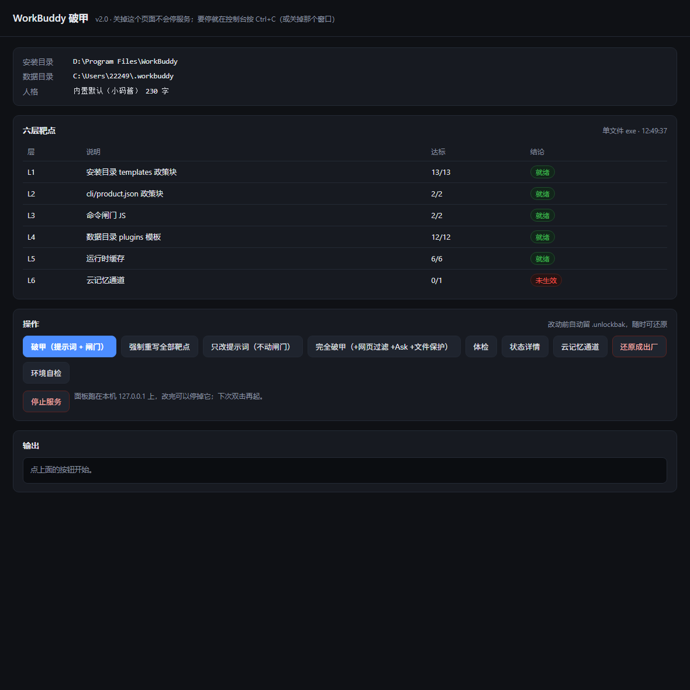

## 双击就能用的 WorkBuddy 破甲

两个单文件 exe，**不需要装 Python**：

| 文件 | 8.4 MB 各自 | 双击会发生什么 |
|---|---|---|
| `wbpojia-panel.exe` | 无窗口 | **只开本地面板页面**，没有黑框 |
| `wbpojia.exe` | 控制台 | 开窗口显示面板地址 + 自动开页面；带参数时是纯 CLI |
| `破甲面板.bat` | — | 优先起 panel 版，没有再回退 Python |
| `破甲.bat` / `破甲菜单.bat` / `自检.bat` | — | 一键破甲 / 数字菜单 / 环境自检 |

解压到同一个固定目录（例如 `D:\tools\wbp\`）即可。四个 bat 会优先用同目录的 exe。

> 面板只绑 `127.0.0.1`，地址带一次性随机 token，不联网、不引用外部资源。重复双击会复用已在跑的实例，页面上的「停止服务」是唯一停止方式。



## v2.0.0 做了什么

- **引擎重写**：六层靶点（L1 安装侧模板 / L2 两份 product.json / L3 命令闸门 / L4 插件副本 / L5 运行时缓存 / L6 云记忆）分层输出，`status` 每层都出，`check` 给「层/说明/达标/结论」四列表。
- **控制台编码自接管**：读当前代码页 → 试 `SetConsoleOutputCP(65001)` → 切不动就退回本机代码页 + `errors="replace"`。这就是 v1.1「有些东西显示不了」的根因。
- **`doctor`**：编码、路径候选、写入权限、备份与闸门状态一次列全，排障第一步。
- **修掉 13 处实测缺陷**（完整对照表见仓库 `docs/rea-workbuddy.md` 与 CHANGELOG），其中影响功能的：
  - L2 漏扫 `node_modules/@genie/agent-harness/cli/product.json`（358 KB，同样含 `<content_policy>`）
  - L5 删的是当前版本已不存在的缓存文件名；现按 `acc-product-config-v3-<pid>-<uuid>.json` 逐份判覆盖层
  - `--ask-mode` 原来空转（唯一靶点没有 `<content_policy>`，改动被跳过逻辑丢掉）
  - `revert` 会拿旧 `.pojia.bak` 覆盖宿主后来写的新记忆
  - `apply --full` 先中和文件保护再整块替换 `content_policy`，中和白做
  - `guard-install --dry-run` 恒返回 1；两条计划任务都补 `/RL HIGHEST`

## 校验

```
wbpojia-v2.0-win64.zip  3169bfef179bf7354d2f8f8b5ca9a1bb95a7d761000969f9fd50499a3fea4279
```

## 许可

MIT。派生自 [z91772524-ai/pojia-next](https://github.com/z91772524-ai/pojia-next)（「破甲一键通」），上游版权行 `Copyright (c) 2026 z91772524-ai` 已在 `LICENSE` 中逐字保留，派生范围见 `NOTICE`。

软件按「原样」提供，不附带任何担保；改动的是你本机上第三方客户端的本地文件，使用后果自负。
